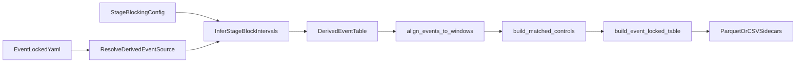

# Derived Block-End Event-Locked Export

## Goal
Implement a generic `event_locked` source that derives block-end events from inferred stage blocks, then runs the existing event-locked pipeline (`EventTable -> alignment -> optional controls -> export`) without creating a new HDF5/summarize contract in the first version.



## Why This Fits The Current Architecture
The existing reusable seam is already present:
- [H:/SourceRepo2/NeuralManifoldDynamics/mndm/src/mndm/pipeline/stage_blocking.py](H:/SourceRepo2/NeuralManifoldDynamics/mndm/src/mndm/pipeline/stage_blocking.py) already exposes `StageBlockInterval(start_sec, end_sec, stage_code, block_id, block_parameter, ...)`.
- [H:/SourceRepo2/NeuralManifoldDynamics/mndm/src/mndm/pipeline/event_alignment.py](H:/SourceRepo2/NeuralManifoldDynamics/mndm/src/mndm/pipeline/event_alignment.py) already supports generic relative-time bins and overlap logic.
- [H:/SourceRepo2/NeuralManifoldDynamics/mndm/src/mndm/pipeline/event_locked_export.py](H:/SourceRepo2/NeuralManifoldDynamics/mndm/src/mndm/pipeline/event_locked_export.py) already builds auditable sidecar tables from aligned event rows.

The missing piece is a generic resolver that synthesizes an `EventTable` from inferred blocks before alignment.

## Implementation Plan
### 1. Add a generic derived-event resolver
Create a small pure helper, likely in [H:/SourceRepo2/NeuralManifoldDynamics/mndm/src/mndm/pipeline/event_annotations.py](H:/SourceRepo2/NeuralManifoldDynamics/mndm/src/mndm/pipeline/event_annotations.py) or a sibling `event_locked_runner.py`, that can build an `EventTable` from `StageBlockInterval` objects.

First version should emit one derived point-event per block:
- `onset_sec = end_sec`
- `duration_sec = 0`
- `event_type = "stage_block_end"`
- provenance fields include `block_id`, `stage_code`, `block_parameter`, and `source = "derived:stage_blocking"`

### 2. Extend `event_locked` config with a generic source kind
Add config support in [H:/SourceRepo2/NeuralManifoldDynamics/mndm/src/mndm/pipeline/event_locked_config.py](H:/SourceRepo2/NeuralManifoldDynamics/mndm/src/mndm/pipeline/event_locked_config.py) for something like:
- `event_source.kind: "derived_stage_block_end"`
- optional filters for block labels / stage codes / block parameters

This should reuse the dataset's existing `epoching.datasets.<id>.sampling.stage_blocking` config rather than duplicating block logic under `event_locked`.

### 3. Factor a small event-locked runner
Extract the smoke-test orchestration pattern into a reusable internal runner that:
- resolves config/profile
- resolves or synthesizes an `EventTable`
- calls `align_events_to_windows`
- optionally calls `build_matched_controls`
- calls `build_event_locked_table`
- writes Parquet/CSV sidecars

This should pull shared orchestration logic out of the smoke scripts and make the new source available without dataset-specific code.

### 4. Keep summarize/H5 unchanged in v1
Do not add a new HDF5 group or summarize-side event contract in the first version.

Specifically:
- keep `/labels/stage` semantics unchanged
- keep `/event_windows` unchanged
- keep `run_manifest.json` field-guide unchanged unless a new sidecar manifest entry is naturally needed

The first version should remain a sidecar-level analytical export, not a new primary tensor contract.

### 5. Make export semantics generic
Update [H:/SourceRepo2/NeuralManifoldDynamics/mndm/src/mndm/pipeline/event_locked_export.py](H:/SourceRepo2/NeuralManifoldDynamics/mndm/src/mndm/pipeline/event_locked_export.py) where needed so naming is not spindle-specific. In particular, avoid assumptions like `spindle_event` being the only event condition label in the exported tables or manifest counts.

## Suggested Initial Config Shape
Document a generic pattern like:

```yaml
event_locked:
  datasets:
    ds006036:
      enabled: true
      event_source:
        kind: "derived_stage_block_end"
      event_types: ["stage_block_end"]
      reference: "onset"
      bins_sec:
        in_block_tail: [-8, 0]
        post_0_8: [0, 8]
        post_8_16: [8, 16]
      min_overlap_fraction: 0.0
      export:
        write_parquet: true
        write_csv: true
```

This keeps the design generic: `ds006036` is only a first consumer, not a special case.

## Tests
Add focused coverage in:
- [H:/SourceRepo2/NeuralManifoldDynamics/mndm/tests/test_event_locked_export.py](H:/SourceRepo2/NeuralManifoldDynamics/mndm/tests/test_event_locked_export.py)
  - derived block-end rows build/export correctly
  - provenance fields are present and generic
- [H:/SourceRepo2/NeuralManifoldDynamics/mndm/tests/test_event_alignment.py](H:/SourceRepo2/NeuralManifoldDynamics/mndm/tests/test_event_alignment.py)
  - block-end point events align to post-block bins as expected
- [H:/SourceRepo2/NeuralManifoldDynamics/mndm/tests/test_epoch_selection_point_events.py](H:/SourceRepo2/NeuralManifoldDynamics/mndm/tests/test_epoch_selection_point_events.py)
  - preserve current block-end semantics and membership behavior as the upstream truth
- optionally [H:/SourceRepo2/NeuralManifoldDynamics/mndm/tests/test_event_annotations.py](H:/SourceRepo2/NeuralManifoldDynamics/mndm/tests/test_event_annotations.py)
  - `StageBlockInterval -> EventTable` synthesis helper

Key first-version edge cases:
- inferred block end from carrier duration vs bridge tail vs next carrier
- adjacent block boundaries
- zero/rare block counts
- strict block-membership modes not changing the block-end timestamp semantics

## Docs / Templates
Update:
- [H:/SourceRepo2/NeuralManifoldDynamics/mndm/README.md](H:/SourceRepo2/NeuralManifoldDynamics/mndm/README.md)
- [H:/SourceRepo2/NeuralManifoldDynamics/README.md](H:/SourceRepo2/NeuralManifoldDynamics/README.md)
- [H:/SourceRepo2/NeuralManifoldDynamics/mndm/Output_variables_guide.md](H:/SourceRepo2/NeuralManifoldDynamics/mndm/Output_variables_guide.md)
- [H:/SourceRepo2/NeuralManifoldDynamics/mndm/config/config_template.yaml](H:/SourceRepo2/NeuralManifoldDynamics/mndm/config/config_template.yaml)
- [H:/SourceRepo2/NeuralManifoldDynamics/mndm/config/eeg_config_ingest_template.yaml](H:/SourceRepo2/NeuralManifoldDynamics/mndm/config/eeg_config_ingest_template.yaml)

Document this explicitly as a generic derived-event sidecar layer for post-block / lagged analyses, not as a replacement for the main stage label surface.

## First Consumer
Use [H:/SourceRepo2/NeuralManifoldDynamics/mndm/config/config_ingest_ds006036.yaml](H:/SourceRepo2/NeuralManifoldDynamics/mndm/config/config_ingest_ds006036.yaml) as the first example dataset after the generic core is in place, with bins centered on block end and early post-block windows.